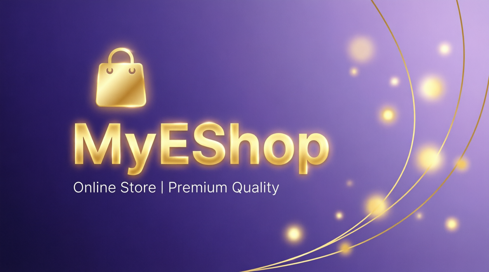
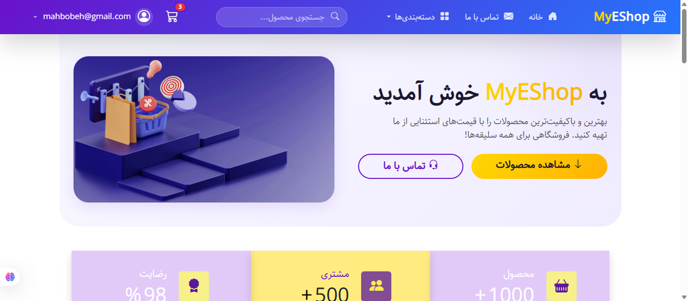
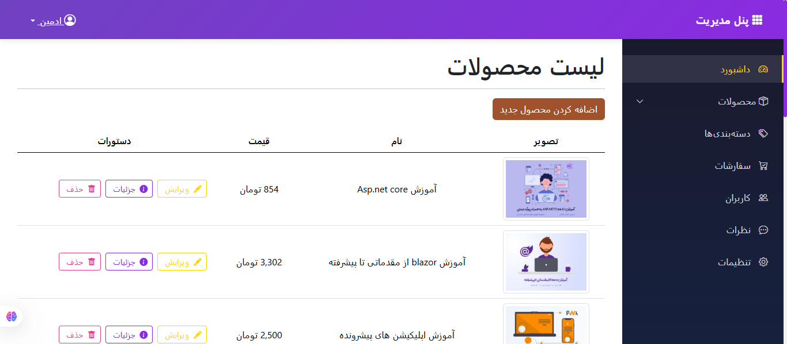
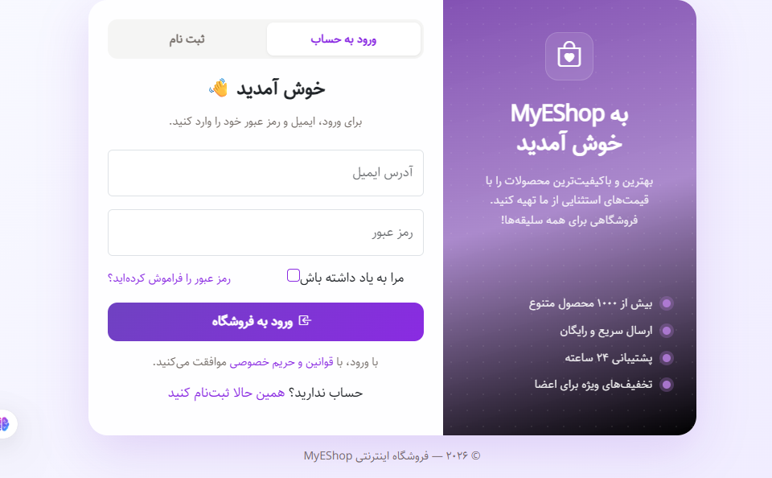
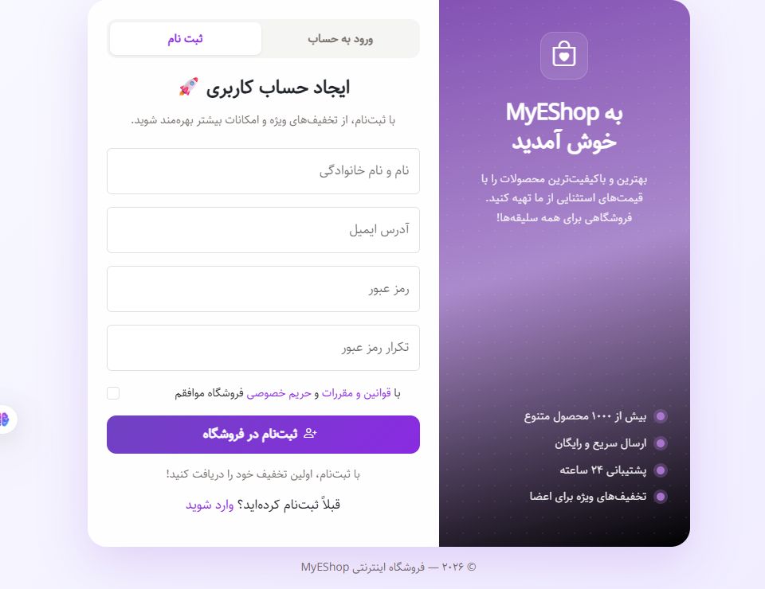

<div align="center">
  <!-- پیشنهاد می‌شود یک بنر (banner) خوشگل از پروژه در پوشه screenshots بسازی و اینجا بذاری -->
  
  
  <h1>🛍️ MyEShop</h1>
  <h3>✨ A Modern, Full-Featured E-Commerce Platform ✨</h3>
  <p><i>Built with ASP.NET Core 8, EF Core, and Bootstrap 5</i></p>

  <p>
    <a href="http://eshopweb.runasp.net/"></a>
    <a href="https://github.com/rita00st/MyEShop/stargazers"></a>
    <a href="https://github.com/rita00st/MyEShop/network/members"></a>
    <a href="https://github.com/rita00st/MyEShop/blob/main/LICENSE"></a>
  </p>

  <p>
    
    
    
    
    
    
  </p>

  <br>
  
  > 🌍 **Try the Live App:** [**eshopweb.runasp.net**](http://eshopweb.runasp.net/)
</div>

---

<details open> 
<summary><b>🇬🇧 English Documentation – Click to expand/collapse</b></summary>
  
## 📖 About the Project

**MyEShop** is a complete and professional e-commerce platform built with **ASP.NET Core 8** and **Entity Framework Core**. It features a **powerful backend** with product management, shopping cart, online payment, and a comprehensive admin panel, paired with a **modern, fully responsive frontend**.

### 🎯 Why I Built This Project?
- 🚀 To deeply master **ASP.NET Core MVC** and **Razor Pages**
- 💳 To integrate a real-world **online payment gateway** (ZarinPal)
- 📊 To practice **Database Design** with **EF Core Code-First** and Migrations
- 🎨 To implement **Responsive UI** using **Bootstrap 5** and custom CSS
- 🛡️ To manage **Authentication, Authorization**, and **Security** best practices
- ⚙️ To set up a **CI/CD Pipeline** using GitHub Actions and deploy to a live server (MonsterASP)

---

## ✨ Key Features

| Section | Features |
|---------|----------|
| **🔐 Authentication** | Cookie-based login/register, distinct **User** and **Admin** roles |
| **📦 Product Management** | Full CRUD operations, category assignment, image upload & preview |
| **🛒 Shopping Cart** | Add/remove items, dynamic price calculation, stock validation |
| **💳 Online Payment** | Seamless integration with **ZarinPal** Payment Gateway |
| **👑 Admin Dashboard** | Advanced stats, charts, full control over products, orders, users, and comments |
| **💬 Comments System** | Users can leave reviews; admins can approve or delete them |
| **📱 Responsive Design** | Mobile-first design, perfectly adapted for all screen sizes |
| **🔍 Advanced Validation** | Client & Server-side validation, password strength checking |

---

## 🛠️ Tech Stack

<details>
<summary><b>📌 Backend</b></summary>

- **Framework:** ASP.NET Core 8 (MVC + Razor Pages)
- **ORM:** Entity Framework Core 8 (Code-First)
- **Database:** SQL Server
- **Authentication:** Cookie Authentication
- **Mapping:** AutoMapper
- **Deployment:** GitHub Actions + MonsterASP.NET (WebDeploy)

</details>

<details>
<summary><b>🎨 Frontend</b></summary>

- **HTML5 / CSS3 / JavaScript (Vanilla)**
- **Bootstrap 5.3** & **Bootstrap Icons**
- **SweetAlert2** for beautiful alerts
- Custom UI/UX styling inspired by modern e-commerce standards

</details>

---

## 🚀 Getting Started (Local Setup)

### 📦 Prerequisites
- [.NET 8 SDK](https://dotnet.microsoft.com/download/dotnet/8.0)
- [SQL Server](https://www.microsoft.com/en-us/sql-server/sql-server-downloads)
- [Visual Studio 2022](https://visualstudio.microsoft.com/)

### ⚙️ Setup Steps

1. **Clone the repository**
   ```bash
   git clone https://github.com/rita00st/MyEShop.git
   cd MyEShop
   ```

2. **Configure Database**
   Update `appsettings.json` with your local SQL Server connection string:
   ```json
   "ConnectionStrings": {
     "MyConnection": "Server=YOUR_SERVER;Database=EshopCore_DB;Trusted_Connection=True;TrustServerCertificate=True;"
   }
   ```

3. **Apply Migrations**
   The project is configured to automatically apply migrations on startup (`context.Database.Migrate()` in `Program.cs`). Just run the app.

4. **Run the Project**
   ```bash
   dotnet run
   ```
   Navigate to `https://localhost:xxxx`.

---

## 📸 Screenshots

<div align="center">
  <table>
    <tr>
      <td align="center"><b>🏠 Home Page</b></td>
      <td align="center"><b>📋 Admin Dashboard</b></td>
    </tr>
    <tr>
      <td></td>
      <td></td>
    </tr>
    <tr>
      <td align="center"><b>🔐 Login</b></td>
      <td align="center"><b>📝 Register</b></td>
    </tr>
    <tr>
      <td></td>
      <td></td>
    </tr>
  </table>
</div>

---

## 👨‍💻 Developer

<div align="center">
  <a href="https://github.com/rita00st">
    
  </a>
  <h3>🌟 Mahbobeh Sadat Tabatabaeian</h3>
  <p>Full-Stack .NET Developer | Security Enthusiast</p>

  [](https://github.com/rita00st)
  [](mailto:mahbobeh138383@gmail.com)
</div>

---

<div align="center">
  <p><i>Made with ❤️ and ☕ in Iran</i></p>
</div>
</details>

---

<details>
<summary><b>🇮🇷 مستندات فارسی (Persian) – برای باز و بسته کردن کلیک کنید</b></summary>
<br>

<div dir="rtl" align="right">

## 📖 درباره پروژه

**MyEShop** یک فروشگاه اینترنتی کامل، مدرن و حرفه‌ای است که با **ASP.NET Core 8** و **Entity Framework Core** توسعه یافته است. این پروژه دارای یک **بک‌اند قدرتمند** (مدیریت محصولات، سبد خرید، درگاه پرداخت و پنل ادمین) و یک **فرانت‌اند واکنش‌گرا** با استفاده از **Bootstrap 5** است.

### 🎯 چرا این پروژه را ساختم؟
- 🚀 برای تسلط عمیق بر **ASP.NET Core MVC** و **Razor Pages**
- 💳 برای یادگیری فرآیند اتصال به **درگاه‌های پرداخت آنلاین** (زرین‌پال)
- 📊 تمرین طراحی دیتابیس و کار با **EF Core (Code-First)**
- 🎨 پیاده‌سازی رابط کاربری مدرن و **کاملاً ریسپانسیو**
- 🛡️ تمرکز بر روی **امنیت**، احراز هویت و مدیریت نقش‌ها
- ⚙️ راه‌اندازی سیستم **CI/CD** با GitHub Actions و انتشار خودکار روی هاست

---

## ✨ ویژگی‌های برجسته

| بخش | ویژگی‌ها |
|-----|----------|
| **🔐 احراز هویت** | ورود و ثبت‌نام امن با کوکی، تفکیک نقش «کاربر» و «مدیر» |
| **📦 مدیریت محصولات** | افزودن، ویرایش، حذف، تخصیص دسته‌بندی و آپلود تصویر |
| **🛒 سبد خرید** | افزودن، حذف، تغییر تعداد و محاسبه خودکار قیمت نهایی |
| **💳 پرداخت آنلاین** | اتصال کامل به درگاه **زرین‌پال** |
| **👑 پنل مدیریت** | داشبورد آماری، نمودار فروش و مدیریت کامل محصولات، کاربران، سفارشات و کامنت‌ها |
| **💬 سیستم نظرات** | ثبت نظر برای محصولات و مدیریت (تایید/حذف) نظرات در پنل ادمین |
| **📱 طراحی واکنش‌گرا** | نمایش بی‌نقص در موبایل، تبلت و دسکتاپ |
| **🚀 دیپلوی خودکار** | استقرار خودکار با هر `push` روی سرور |

---

## 🛠️ تکنولوژی‌های استفاده شده

- **بک‌اند:** ASP.NET Core 8, EF Core 8, SQL Server, AutoMapper
- **فرانت‌اند:** Bootstrap 5.3, HTML5, CSS3, Vanilla JavaScript, SweetAlert2
- **دیپلوی:** GitHub Actions, MonsterASP.NET

---

## 🚀 نصب و راه‌اندازی (لوکال)

۱. **کلون کردن مخزن:**

   <div dir="ltr" align="left">
     
   ```bash
   git clone https://github.com/rita00st/MyEShop.git
   ```
   
   </div>
   
۲. **تنظیم دیتابیس:**
   رشته اتصال (Connection String) خود را در `appsettings.json` قرار دهید.
   
۳. **اجرا:**
   پروژه طوری تنظیم شده که هنگام اجرا، مایگریشن‌ها را به صورت خودکار روی دیتابیس اعمال کند.
<div dir="ltr" align="left">
 
   ```bash
   dotnet run
   ```

</div>

---

## 📸 تصاویر پروژه

<div align="center">
  <table>
    <tr>
      <td align="center"><b>🏠 صفحه خانه</b></td>
      <td align="center"><b>📋 داشبورد ادمین</b></td>
    </tr>
    <tr>
      <td></td>
      <td></td>
    </tr>
    <tr>
      <td align="center"><b>🔐 صفحه ورود</b></td>
      <td align="center"><b>📝 صفحه ثبت نام</b></td>
    </tr>
    <tr>
      <td></td>
      <td></td>
    </tr>
  </table>
</div>

---

## 🤝 مشارکت

اگر ایده یا پیشنهادی برای بهتر شدن پروژه داری، خوشحال می‌شوم یک **Issue** ثبت کنی یا **Pull Request** بفرستی.

---

<div align="center">
  <p>ساخته شده با ❤️ و ☕ در ایران</p>
  <p>«کد بنویسید، زیبا زندگی کنید، و به دیگران کمک کنید.»</p>
</div>

</div>
</details>

